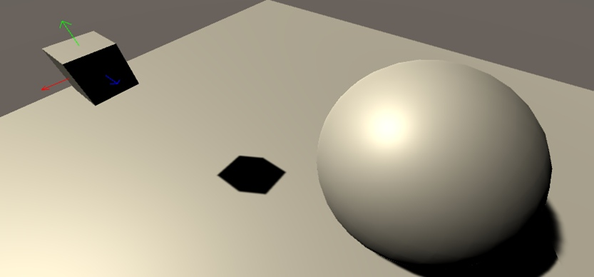

# Runtime Translation Gizmo for Unity

A runtime translation gizmo that appears when you select a Unity scene object and lets you drag it along three axes.

**Stack:** Unity 2020.3.14f1 · C# · Unity GL

**My role:** Danil Volodin — developed the object-selection and translation script as part of a human–machine interface project.

## Run locally

1. Open this repository in Unity **2020.3.14f1**, the version recorded in `ProjectSettings/ProjectVersion.txt`.
2. Open `Assets/Scenes/SampleScene.unity` and inspect the objects and script assignments.
3. Enter Play mode. Click an object with the `DragnDrop` component, then drag an axis handle to move it. Click empty space to hide the gizmo.

To use it in another project:

1. Copy [`Assets/Scripts/DragnDrop.cs`](Assets/Scripts/DragnDrop.cs) into your project's scripts folder.
2. Attach `DragnDrop` to the object you want to move. Give the object a collider so mouse selection can hit it, and tag the scene camera `MainCamera`.
3. Enter Play mode and select the object. The script creates trigger colliders for the axis handles at runtime.

## How it works

- Clicking an object with the script shows its translation axes; clicking empty space hides them.
- Dragging a handle changes the corresponding position coordinate.
- The arrows use the object's local-to-world matrix, so their visual size follows the object's transform scale.
- Unity's low-level `GL` API draws the colored axis lines. No CPU-performance measurements are claimed.

## Status and limits

Preserved as a human–machine interface prototype. The surviving original screenshot is stored locally in `docs/screenshots/`. Compatibility with newer Unity versions has not been revalidated. The source uses the legacy mouse input API, physics raycasts and `Hidden/Internal-Colored`; other input or rendering setups may need adaptation. The visual arrows follow object scale, while the generated handle colliders use fixed local dimensions.

## License

Original project code is available under the [MIT License](LICENSE). Any bundled third-party components retain their own licensing terms.
